<div align="center">
  
</div>

<p align="center">
  <a href="https://portfolio-card-ten-nu.vercel.app"></a>
  <a href="https://www.linkedin.com/in/pratik-chittroda/"></a>
  <a href="https://www.instagram.com/pratik.limitless"></a>
</p>

<br />


```ts
const pratik = {
  role:      "app developer who ships",
  loves:     ["rough sketch → real product", "interfaces that feel alive", "a little bit of magic"],
  building:  ["web & mobile experiments", "local-first AI tools", "practical AI features"],
  sweats:    ["motion", "accessibility", "the last 10% of polish"],
  philosophy: "shipping over perfecting — then iterate",
} as const;
```



<br />


<p align="center">
  <a href="https://project1-7a465.web.app"></a>
  <a href="https://portfolio-card-ten-nu.vercel.app"></a>
</p>

<p align="center">
  <a href="https://project1-7a465.web.app"></a>
  <a href="https://github.com/pratikchittroda-cpu/Project-diploma"></a>
</p>

<br />



<!-- LAB-CARDS:START -->
<p align="center">
  <a href="https://github.com/pratikchittroda-cpu/ReleaseArc"></a>
  <a href="https://github.com/pratikchittroda-cpu/Manga-Forge-"></a>
  <a href="https://github.com/pratikchittroda-cpu/ForgeCode"></a>
  <a href="https://github.com/pratikchittroda-cpu/Valentine"></a>
</p>
<!-- LAB-CARDS:END -->

<details>
  <summary><b>📟 &nbsp;open the lab notes</b></summary>
  <br />

<!-- LAB-NOTES:START -->

| Experiment | The question it asks |
| :--- | :--- |
| [**ReleaseArc**](https://github.com/pratikchittroda-cpu/ReleaseArc) | Can sprint plans, pull requests and CI tell you, in one view, whether a release is [actually on track](https://project-pulse-navy.vercel.app)? |
| [**MangaForge AI**](https://github.com/pratikchittroda-cpu/Manga-Forge-) | How far can one idea go — story, characters and panels — before a human has to pick up the pen? |
| [**ForgeCode**](https://github.com/pratikchittroda-cpu/ForgeCode) | Can a local LLM on a 16 GB laptop run a real *Plan → Execute → Verify* loop — with tree-sitter guarding every patch? |
| [**Valentine**](https://github.com/pratikchittroda-cpu/Valentine) | What if the "No" button simply refused to be clicked? |
| [**Expenzo**](https://github.com/pratikchittroda-cpu/Project-diploma) | Can a finance AI ask for consent first and keep keys out of the app bundle? |
| [**Portfolio Card**](https://github.com/pratikchittroda-cpu/Portfolio-Card) | How much of "me" fits on one card at [one link](https://portfolio-card-ten-nu.vercel.app)? |

<!-- LAB-NOTES:END -->

</details>

<br />


<p align="center">
  <a href="https://skillicons.dev"></a>
  <br />
  <a href="https://skillicons.dev"></a>
</p>

<br />


<div align="center">
  
  <br /><br />
  
  <br />
  <sub><code>// a snake eats my contribution grid every night at 00:00 UTC. feed it.</code></sub>
</div>

<br />


> **Got a strong idea, a tricky interaction, or an interesting AI angle?**
> That's my favourite kind of problem. Ping me anywhere below — I usually reply faster than my builds finish.

<p align="center">
  <a href="https://www.linkedin.com/in/pratik-chittroda/"></a>
  <a href="https://www.instagram.com/pratik.limitless"></a>
  <a href="https://portfolio-card-ten-nu.vercel.app"></a>
</p>

<br />

<div align="center">
  
  <br />
  
</div>

<details>
  <summary><sub>🛠️ profile repo maintenance</sub></summary>
  <br />

Every animated graphic above is a hand-rolled SVG committed to this repo — no third-party card services to rate-limit or break.

```bash
node scripts/build-assets.mjs   # regenerate everything in assets/
make test                       # validate the README
```

The `snake.yml` workflow refreshes the contribution snake daily; push to `main` and GitHub does the rest.

The `lab.yml` workflow runs `scripts/update-lab.mjs` every day so the lab always shows the most recently committed public repos. Hand-written card copy lives in `scripts/lab-catalog.mjs`; repos without an entry there get a card built from their GitHub description.

</details>
